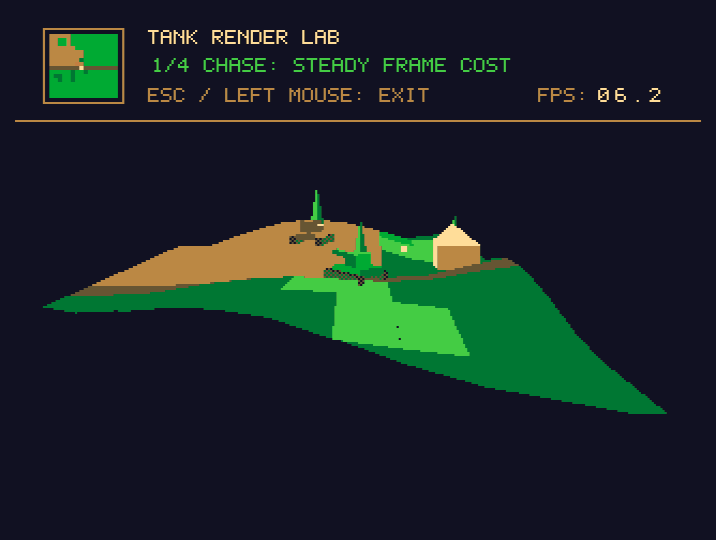

# Tank Render Lab

A four-stage rendering benchmark for a PAL Amiga 500 with a 68000, OCS and 512 KiB of Chip RAM. It runs Chase, Approach/Fire, Scenery In and Scenery Out with the B86 renderer, live FPS and a final per-stage results screen. The scenes and assets are original to Tank Render Lab, not extracted from Conqueror.



## Run

Get the executable and ADF from [Releases](https://github.com/rmtew/conqueror-terrain-test/releases). If the latest build hasn't been released yet, download the `TankRenderLab` artifact from the latest successful [Actions run](https://github.com/rmtew/conqueror-terrain-test/actions).

Boot `TankRenderLab.adf` in DF0: or run `TankRenderLab` from an AmigaDOS CLI. Press **Space** to start. **Esc** or the **left mouse button** exits.

## Build

Requires Python 3.12+, GCC and make (MinGW-w64 on Windows).

```text
python -m pip install -r requirements.txt
python bin/setup.py
```

Run `./build.sh` (Linux) or `build.bat` (Windows). Both build the executable and bootable OFS ADF in `build/`. The ADF can also be built separately with `python tools/make_adf.py build/TankRenderLab build/TankRenderLab.adf`.

All program code and data are in `tank_render_lab.s`. The two includes define the Devpac-compatible Amiga hardware and OS symbols used by the program. `bin/setup.py` builds the pinned vasm archive into `bin/`; see the enclosed manual for distribution terms.
